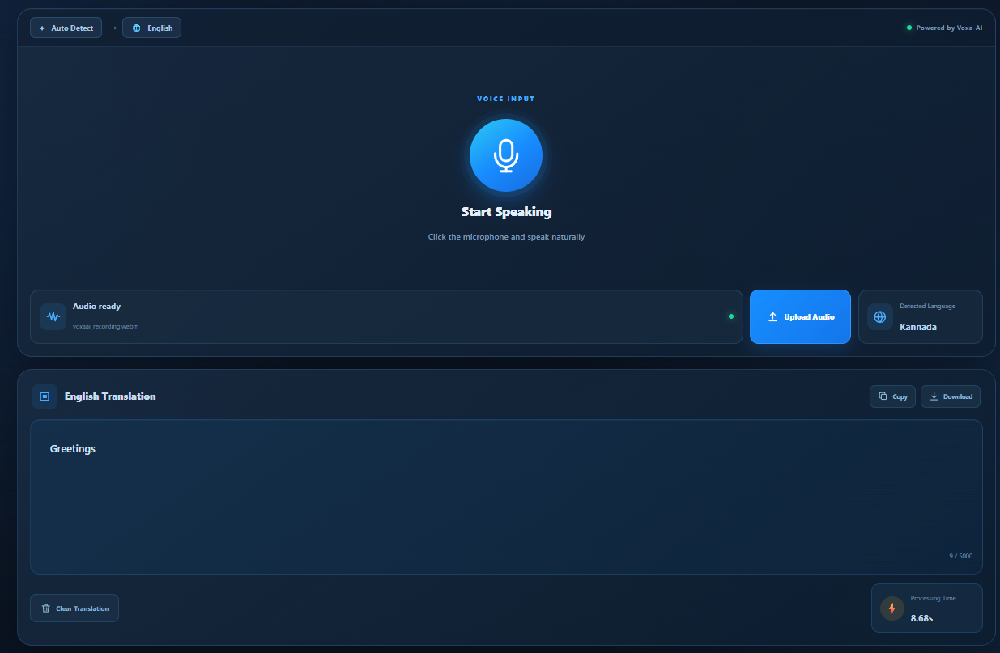
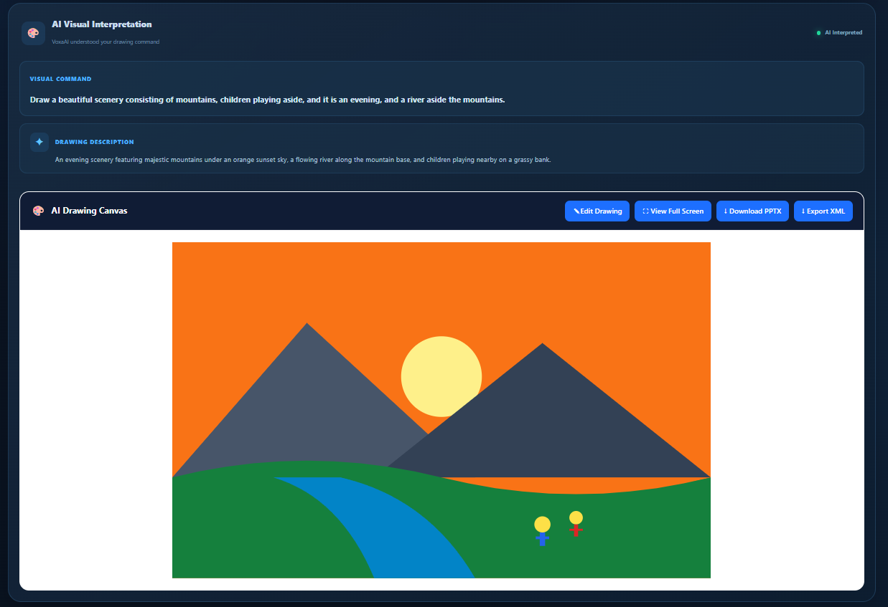
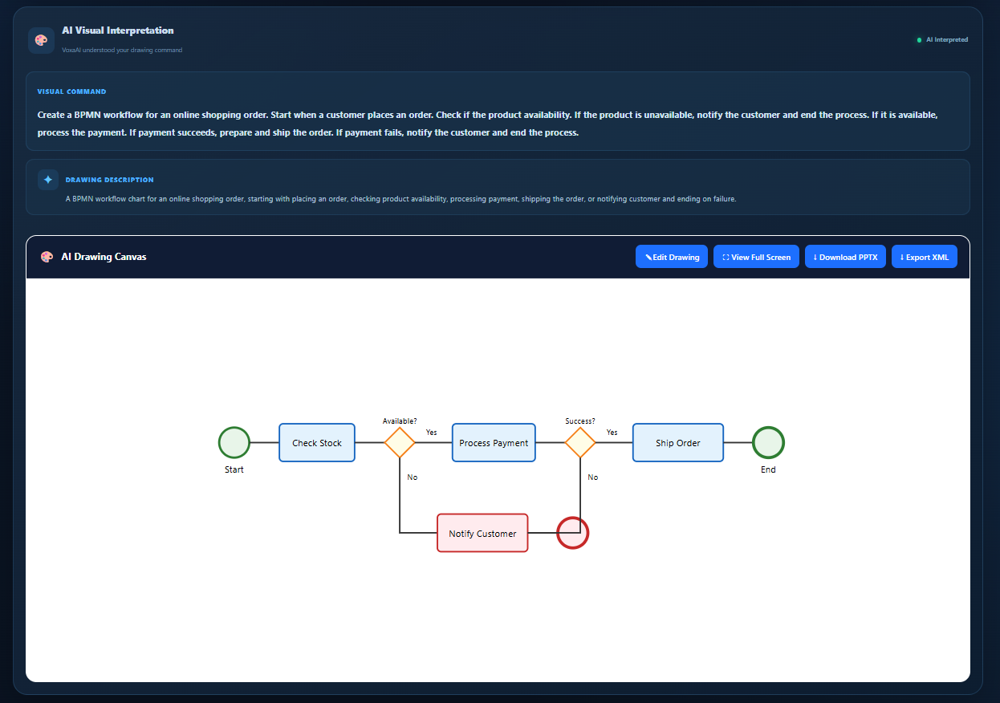
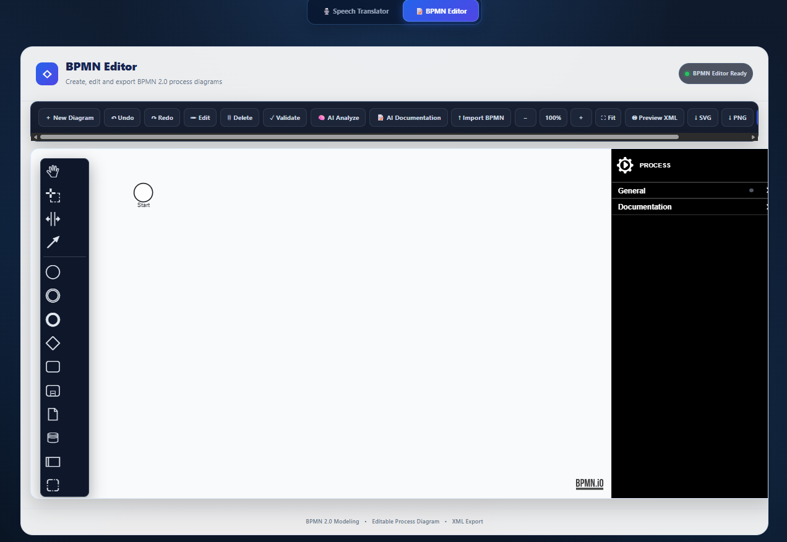
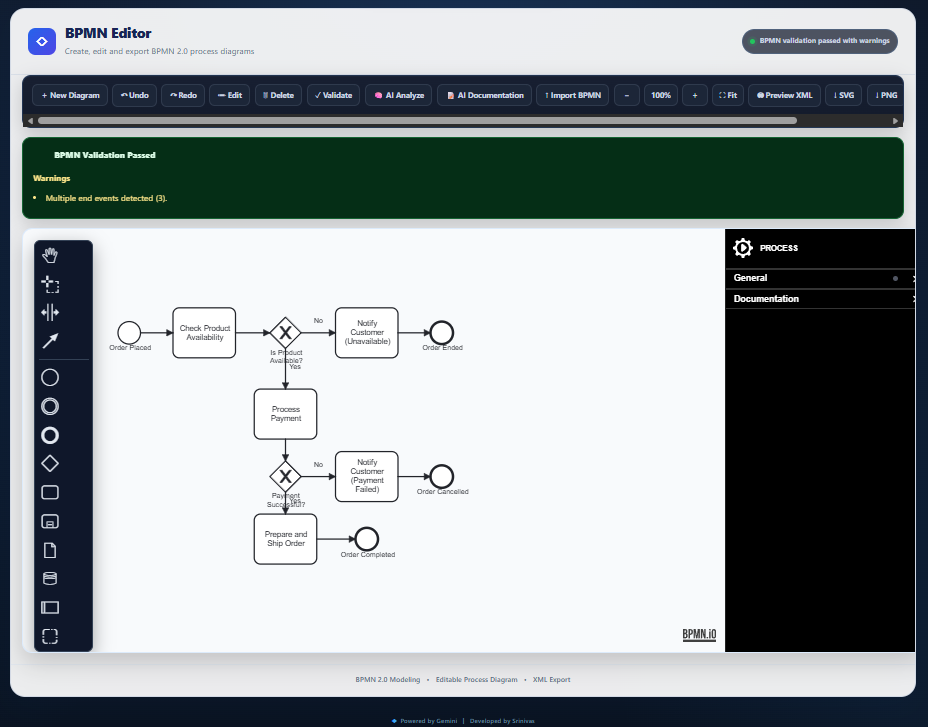

# VoxaAI

### AI-Powered Multilingual Speech Translation & Workflow Intelligence Platform

VoxaAI is an AI-powered application that transforms natural-language speech and instructions into meaningful digital outputs.

It combines **multilingual speech translation, AI-powered visual intelligence, and BPMN workflow intelligence** into a single platform. Users can translate spoken language, generate visual representations, create editable BPMN 2.0 workflows, validate processes, analyze workflows using AI, and automatically generate professional workflow documentation.

---

## ✨ Features

### 🎙️ MultiLingual Speech Transaltion 

- Microphone-based speech innput
- Audio file processing
- Automatic language detection
- English translation
- Processing-time measurement
- Copy and clear translation
- Structured AI response
- Retry and fallback handling for temporary AI service failures

### 🎨 AI Visual Intelligence

VoxaAI understands natural-language visual instructions and converts them into visual representations.

Example:

> "Draw a flowchart showing a user entering credentials, verifying them, and either accessing the dashboard or retrying."

Capabilities include:

- AI visual-command detection
- Visual description generation
- SVG diagram generation
- Editable AI drawing canvas
- Visual element manipulation
- PowerPoint export

### 🔄 AI-Powered BPMN Generation

VoxaAI converts natural-language workflow instructions into **BPMN 2.0 process diagrams**.

Example:

> "Create a BPMN workflow for an employee leave approval process."

The generated BPMN workflow can be opened directly in the integrated BPMN editor for further editing and validation.

### 🧩 BPMN 2.0 Editor

The integrated BPMN editor provides:

- BPMN 2.0 process modeling
- Drag-and-drop workflow design
- Tasks and activities
- Start and end events
- Gateways
- Sequence flows
- Element editing
- Element deletion
- Undo / Redo
- Zoom controls
- BPMN import
- Properties panel

### ✅ Advanced BPMN Validation

VoxaAI performs deterministic BPMN workflow validation, including:

- Missing start events
- Missing end events
- Invalid sequence flows
- Missing incoming connections
- Missing outgoing connections
- Unreachable workflow elements
- Dead-end paths
- Disconnected workflow components
- Gateway structural issues
- Multiple start/end event warnings

### 🧠 AI Workflow Analysis

Existing BPMN workflows can be analyzed using AI to generate:

- Process summary
- Workflow strengths
- Identified issues
- Automation opportunities
- Recommendations

### 📝 AI Workflow Documentation

VoxaAI automatically generates professional workflow documentation from BPMN workflows.

Generated documentation includes:

- Process Overview
- Workflow Steps
- Business Rules
- Key Decisions
- Roles & Responsibilities

### 📤 BPMN Export

Workflows can be exported as:

- BPMN 2.0 XML
- SVG
- PNG

BPMN XML can also be previewed and copied directly from the application.

---

## 📸 Application Preview

### 🎙️ Speech Translation

VoxaAI accepts microphone or audio input, automatically detects the spoken language, and generates an English translation.



---

### 🎨 AI Visual Intelligence

Natural-language visual commands can be interpreted by the AI and converted into editable visual representations.




---

### 🔄 BPMN Workflow Editor

AI-generated BPMN workflows can be opened and edited directly using the integrated BPMN 2.0 workflow editor.



---

### ✅ BPMN Validation

Workflows can be structurally validated to identify potential BPMN modeling issues and warnings.



---

### 🧠 AI Workflow Analysis

VoxaAI analyzes BPMN workflows and provides process insights, identified issues, automation opportunities, and recommendations.


---

### 📝 AI Workflow Documentation

The platform automatically generates structured business-process documentation from BPMN workflows.


---

# 🏗️ System Architecture

VoxaAI follows a modular architecture consisting of a React-based frontend, Flask backend, AI processing layer, and BPMN workflow engine.

```text
                              ┌──────────────────────┐
                              │        USER          │
                              │                      │
                              │  🎙️ Speech / Audio   │
                              │  📝 Natural Language │
                              └──────────┬───────────┘
                                         │
                                         ▼
┌─────────────────────────────────────────────────────────────────────┐
│                         VOXAAI FRONTEND                             │
│                         React + Vite                                │
│                                                                     │
│  ┌─────────────────┐    ┌──────────────────┐    ┌────────────────┐ │
│  │ Speech          │    │ Visual           │    │ BPMN           │ │
│  │ Translator      │    │ Intelligence     │    │ Workspace      │ │
│  │                 │    │                  │    │                │ │
│  │ • Audio Input   │    │ • Visual Command │    │ • BPMN Editor  │ │
│  │ • Translation   │    │ • SVG Canvas     │    │ • Properties   │ │
│  │ • Language      │    │ • Editing        │    │ • Import       │ │
│  │   Detection     │    │ • PPTX Export    │    │ • Export       │ │
│  └────────┬────────┘    └────────┬─────────┘    └───────┬────────┘ │
│           │                      │                      │          │
└───────────┼──────────────────────┼──────────────────────┼──────────┘
            │                      │                      │
            └──────────────────────┼──────────────────────┘
                                   │
                              HTTP / REST
                                   │
                                   ▼
┌─────────────────────────────────────────────────────────────────────┐
│                         FLASK BACKEND                               │
│                            Python                                   │
│                                                                     │
│  ┌─────────────────┐    ┌──────────────────┐    ┌────────────────┐ │
│  │ /process        │    │ /analyze-bpmn    │    │ /document-bpmn │ │
│  │                 │    │                  │    │                │ │
│  │ Audio           │    │ Workflow         │    │ Workflow       │ │
│  │ Processing      │    │ Analysis         │    │ Documentation  │ │
│  └────────┬────────┘    └────────┬─────────┘    └───────┬────────┘ │
│           │                      │                      │          │
│           └──────────────────────┼──────────────────────┘          │
│                                  │                                 │
│                    Structured AI Processing                         │
└──────────────────────────────────┼─────────────────────────────────┘
                                   │
                                   ▼
┌─────────────────────────────────────────────────────────────────────┐
│                         GOOGLE GEMINI                               │
│                                                                     │
│  ┌──────────────┐  ┌──────────────┐  ┌──────────────────────────┐ │
│  │ Language     │  │ Visual       │  │ Workflow Intelligence    │ │
│  │ Intelligence │  │ Intelligence │  │                          │ │
│  │              │  │              │  │ • BPMN Generation         │ │
│  │ • Detection  │  │ • Intent     │  │ • BPMN Analysis           │ │
│  │ • Translation│  │ • SVG        │  │ • Documentation            │ │
│  └──────────────┘  └──────────────┘  └──────────────────────────┘ │
└─────────────────────────────────────────────────────────────────────┘
                                   │
                                   ▼
┌─────────────────────────────────────────────────────────────────────┐
│                      BPMN WORKFLOW ENGINE                           │
│                           bpmn-js                                   │
│                                                                     │
│   AI Generated BPMN                                                │
│          │                                                          │
│          ▼                                                          │
│   ┌─────────────────────────────────────────────────────────────┐   │
│   │                    BPMN 2.0 MODEL                           │   │
│   │                                                             │   │
│   │  Tasks • Events • Gateways • Sequence Flows • Decisions     │   │
│   └──────────────────────────┬──────────────────────────────────┘   │
│                              │                                      │
│            ┌─────────────────┼──────────────────┐                   │
│            ▼                 ▼                  ▼                   │
│       Validation        AI Analysis       Documentation             │
│            │                 │                  │                   │
│            ▼                 ▼                  ▼                   │
│       Structural        Workflow          Business Process          │
│       Validation        Insights          Documentation              │
│                                                                     │
│                              │                                      │
│                              ▼                                      │
│                    BPMN / SVG / PNG Export                          │
└─────────────────────────────────────────────────────────────────────┘
```
## 🔄 Core Processing Flow
```text
        User Input
            │
            ▼
        Speech / Natural Language
            │
            ▼
        Flask Backend
            │
            ▼
        Google Gemini
            │
            ├──────────────► Translation
            │
            ├──────────────► Visual Understanding
            │                         │
            │                         ▼
            │                    SVG Generation
            │
            └──────────────► BPMN Generation
                                    │
                                    ▼
                                BPMN 2.0 Model
                                    │
                    ┌───────────────┼───────────────┐
                    ▼               ▼               ▼
                Validate         Analyze         Document
                    │               │               │
                    └───────────────┼───────────────┘
                                    ▼
                            Editable BPMN Workflow
                                    │
                                    ▼
                            Export / Preview
```

## 🧩 Architecture Components

### Frontend Layer
Built with React and Vite, the frontend provides the user interface for speech translation, AI visual generation, and BPMN workflow modeling.

### Backend Layer
Built with Python and Flask, the backend handles audio processing, communication with the AI service, structured responses, BPMN analysis, and workflow documentation.

### AI Layer
Google Gemini provides language understanding, translation, visual interpretation, BPMN generation, workflow analysis, and automated documentation.

### BPMN Layer
bpmn-js provides the interactive BPMN 2.0 modeling environment, including editing, properties management, workflow validation, import, and export.

### Output Layer
VoxaAI produces multiple structured outputs:
- English translations
- AI-generated SVG diagrams
- Editable BPMN 2.0 workflows
- BPMN validation results
- AI workflow analysis
- Automated workflow documentation
- BPMN XML
- SVG and PNG exports
---

## 🔄 Application Workflow
```text
        Speech / Audio
            │
            ▼
        Language Detection
            │
            ▼
        English Translation
            │
            ├───────────────────┐
            │                   │
            ▼                   ▼
        Visual Command       BPMN Command
            │                   │
            ▼                   ▼
        SVG Generation       BPMN Generation
                                │
                                ▼
                            BPMN Editor
                                │
                    ┌───────────┼───────────┐
                    │           │           │
                    ▼           ▼           ▼
                Validate     Analyze     Document
                    │           │           │
                    └───────────┼───────────┘
                                ▼
                        Export / Preview
```

---

## 🛠️ Technology Stack

### Frontend

- React
- Vite
- JavaScript
- CSS
- bpmn-js
- bpmn-js-properties-panel
- PptxGenJS

### Backend
- Python
- Flask
- Flask-CORS
- Pydantic
- python-dotenv
- Google GenAI SDK

### AI
- Google Gemini
- Structured AI responses
- Multilingual language understanding
- Visual understanding
- BPMN generation
- Workflow analysis
- Workflow documentation

### Workflow Modeling
- BPMN 2.0
- bpmn-js
- BPMN XML
- BPMN validation

---

## 📁 Project Structure
```text
        Project_Voxa/
        │
        ├── backend/
        │   ├── app.py
        │   ├── requirements.txt
        │   ├── .env
        │   └── uploads/
        │
        ├── frontend/
        │   ├── public/
        │   │
        │   ├── src/
        │   │   ├── assets/
        │   │   ├── App.jsx
        │   │   ├── App.css
        │   │   ├── BpmnEditor.jsx
        │   │   ├── BpmnEditor.css
        │   │   ├── index.css
        │   │   └── main.jsx
        │   │
        │   ├── package.json
        │   ├── package-lock.json
        │   └── vite.config.js
        │
        └── README.md
        │
        └── Screenshots/
```

---

# 🔌 API Documentation

## POST /process
Processes an uploaded audio file and returns translation, visual intelligence, and BPMN information when applicable.

### Request
>            multipart/form-data
>            audio=<audio-file>

### Response
>            {
>            "success": true,
>            "language": "Hindi",
>            "translation": "English translation",
>            "processing_time": 2.31,
>            "is_visual_command": false,
>            "visual_description": "",
>            "drawing_svg": "",
>           "bpmn_xml": ""
>            }

## POST /document-bpmn
Generates professional workflow documentation from BPMN XML.

### Request
>            {
>            "bpmn_xml": "<BPMN 2.0 XML>"
>            }

### Response
>            {
>            "success": true,
>            "process_overview": "Process overview",
>            "workflow_steps": [],
>            "business_rules": [],
>            "key_decisions": [],
>            "roles_responsibilities": []
>            }

---

# ⚙️ Installation & Setup

## Prerequisites
Make sure the following are installed:
- Python 3.x
- Node.js
- npm
- Google Gemini API key

### 1. Clone the Repository
>            git clone <repository-url>
>            cd Project_Voxa

### 2. Backend Setup
Navigate to the backend:
>            cd backend

Create a virtual environment:
>            python -m venv venv

Activate the environment on Windows:
>            venv\Scripts\activate

Install dependencies:
>            pip install -r requirements.txt

Create a .env file inside the backend directory:
>            GEMINI_API_KEY=YOUR_GEMINI_API_KEY

Start the backend:
>            python app.py

Backend server:
>            http://127.0.0.1:5000

### 3. Frontend Setup
Open another terminal and navigate to the frontend:
>            cd frontend

Install dependencies:
>            npm install

Start the development server:
>            npm run dev

Frontend:
>           http://localhost:5173

---

# 🔐 Environment & Security
API credentials are stored using environment variables.

Example:
> GEMINI_API_KEY=YOUR_GEMINI_API_KEY

- Never commit API keys to the repository.
Recommended .gitignore entries:
    .env
    venv/
    node_modules/
    __pycache__/
    *.pyc

---

# 🧠 AI Processing
VoxaAI uses Google Gemini to perform multiple AI tasks:

'''text

        User Input
            │
            ▼
        Google Gemini
            │
            ├── Language Detection
            ├── Translation
            ├── Visual Intent Detection
            ├── SVG Generation
            ├── BPMN Generation
            ├── BPMN Workflow Analysis
            └── BPMN Documentation

The backend uses structured responses to convert AI output into predictable application data.

Temporary AI service availability issues are handled using retry logic and a fallback model to improve application reliability

---

# 📊 BPMN Intelligence
VoxaAI combines deterministic BPMN validation with AI-powered workflow intelligence.

## Deterministic Validation
The application analyzes the BPMN graph itself to detect structural problems such as:
- Unreachable elements
- Dead-end paths
- Missing connections
- Invalid sequence flows
- Disconnected components
- Gateway issues

## AI Workflow Analysis
Gemini provides higher-level insights including:
- Process strengths
- Potential issues
- Automation opportunities
- Recommendations

## AI Documentation
The BPMN model is converted into structured business documentation containing:
- Process Overview
- Workflow Steps
- Business Rules
- Key Decisions
- Roles & Responsibilities

---

# 📌 Feature Summary
**|Category | Capabilities |**
|:-----------:|:-------------:|
| Speech AI | Multilingual speech detection and English translation |
| Audio | Microphone input and audio-file processing |
| Visual AI | Natural-language visual interpretation and SVG generation |
| Drawing | Editable AI-generated visual diagrams |
| Presentation | PowerPoint export |
| BPMN | AI-generated BPMN 2.0 workflows |
| BPMN Editor | Create, edit, connect, delete, undo, redo |
| Validation | Structural BPMN validation |
| AI Analysis | Workflow insights and recommendations |
| Documentation | Automated BPMN documentation |
| Import | BPMN/XML import |
| Export | BPMN XML, SVG and PNG |
| XML | Preview and copy BPMN XML |
| Reliability | Retry and fallback handling for temporary AI failures |

---

# 🎯 Project Objective
VoxaAI aims to bridge the gap between natural-language interaction and structured digital workflows.

Instead of requiring users to manually create translations, diagrams, or business process models, VoxaAI allows them to describe what they need naturally and uses AI to transform those instructions into editable and structured outputs.
'''text
        Natural Language
            ↓
            AI
            ↓
        Translation / Visuals / BPMN
            ↓
        Editable & Validated Output
            ↓
        AI Analysis & Documentation

---

# 🚀 Future Roadmap
The following features are planned as future improvements.

### Workflow Management
- Persistent workflow storage
- Workflow version history
- User authentication
- Cloud deployment

### Advanced BPMN Intelligence
- More comprehensive BPMN semantic validation
- Advanced process-quality analysis
- Enhanced AI workflow recommendations
- AI-assisted workflow optimization

### Collaboration
- Multi-user workflow collaboration
- Shared process workspaces
- Workflow commenting and review

### AI Expansion
- Enhanced multilingual support
- Additional visual generation capabilities
- More advanced workflow understanding
- Automated workflow optimization

### Enterprise Integration
- Integration with external workflow platforms
- Workflow automation
- Enterprise process management capabilities

---

# 👨‍💻 Project Information

**Project:** VoxaAI
**Type:** AI-Powered Multilingual Speech & Workflow Intelligence Platform
**Primary Technologies:**
 'Python' · 'Flask' · 'React' · 'JavaScript' · 'Google Gemini' · 'BPMN 2.0' · 'bpmn-js'